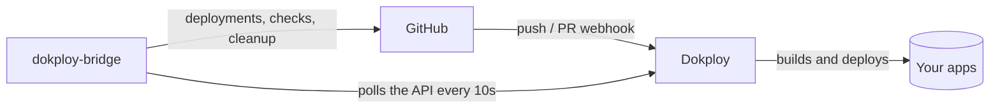

# dokploy-bridge

**Vercel-style GitHub integration for self-hosted [Dokploy](https://dokploy.com).** Every push and pull request gets a deployment in GitHub's Deployments view, a ✅/❌ check with a build report, and preview environments that clean themselves up when the PR closes. New apps start from your own defaults, so there's nothing to configure per repo.

[](https://github.com/prabhask5/dokploy-bridge/actions/workflows/ci.yml)
[](LICENSE)

> Not affiliated with Dokploy. A small companion service that talks to Dokploy's API and to GitHub as Dokploy's own GitHub App.

## What you get

**On every commit and pull request:**
- A **check run** named `Dokploy` (production) or `Dokploy Preview` (PRs). It spins while Dokploy builds, then ends ✅ with the live URL and build time, or ❌ with the error and the last lines of the build log. Secrets from the app's environment are masked.
- A **GitHub Deployment** in `Production` or `Preview (PR #n)`, so the repo's **Deployments** sidebar and the PR timeline show a **View deployment** button.

**When a PR is closed or merged:** once Dokploy removes the preview, its GitHub deployments and `Preview (PR #n)` environment are deleted, so the Deployments view only lists what's live.

**For newly created Dokploy apps:**
- **Defaults** (build type, rollback registry, preview settings) are copied from a template app you choose.
- The **preview port** follows the app's first domain.
- **Preview environment variables** mirror production until you customise them.

Existing apps and past deployments are left alone: on its first run the bridge only records what's already there.

## How it works



- **No webhooks or extra GitHub App to set up.** The bridge polls Dokploy's API, and acts on GitHub with the credentials of the GitHub App Dokploy already uses.
- **No dependencies:** a single small Node.js process.
- **Its state** (what it has already reported) lives in a single JSON file.

## Requirements

- **Dokploy** with apps that deploy from the **GitHub** provider. Plain Git URLs, GitLab, Bitbucket and Gitea aren't supported.
- **A Dokploy API key** of an **owner or admin**, created under *Settings → Profile → API/CLI*. Only owners and admins can read the GitHub App's private key, which the bridge needs to act as that app.
- **The bridge must be able to reach Dokploy's API.** Running it on the `dokploy-network` Docker network next to Dokploy is the simplest.
- **Permissions on Dokploy's GitHub App**, under *GitHub → Settings → Developer settings → GitHub Apps → (your Dokploy app) → Permissions*:

| Repository permission | Access | Used for |
|---|---|---|
| Checks | Read and write | Check runs. Optional: without it the bridge falls back to commit statuses. |
| Deployments | Read and write | Deployments view and preview cleanup |
| Commit statuses | Read and write | Fallback when Checks is missing |
| Contents, Pull requests | Read | Finding the commit being built (Dokploy's app already has these) |
| Administration | Read and write | **Optional.** Deleting empty `Preview (PR #n)` environments. Without it, the deployments are still deleted. |

After changing an app's permissions, GitHub asks you to **accept the new permissions** on each installation (*Settings → Applications → Installed GitHub Apps → Configure*).

## Install

### Option A: Docker Compose on the Dokploy server
```bash
mkdir -p /opt/dokploy-bridge && cd /opt/dokploy-bridge
curl -fsSLO https://raw.githubusercontent.com/prabhask5/dokploy-bridge/main/docker-compose.yml
curl -fsSL https://raw.githubusercontent.com/prabhask5/dokploy-bridge/main/.env.example -o .env
nano .env                 # set DOKPLOY_API_KEY, DOKPLOY_PUBLIC_URL, TEMPLATE_APP
docker compose up -d && docker compose logs -f
```
You should see `dokploy-bridge 0.x.y starting: ...` and then `baseline: N existing app(s) left as configured`.

### Option B: as an app inside Dokploy
1. **Create an application** with source **Docker**, image `ghcr.io/prabhask5/dokploy-bridge:latest`.
2. **Environment:** paste the variables from [`.env.example`](.env.example).
3. **Advanced → Volumes:**
   - bind mount a host folder (e.g. `/opt/dokploy-bridge/data`) to `/data`
   - optionally bind `/etc/dokploy/logs` to `/etc/dokploy/logs`, for build logs in the check report
4. **Turn Preview Deployments off** for this app. A preview would start a second bridge, and you'd get duplicate checks and deployments.
5. **Deploy.** Dokploy apps join `dokploy-network`, so the default `DOKPLOY_URL=http://dokploy:3000` works.

**Run only one instance at a time.** Two bridges would report everything twice.

## Configuration

All settings are environment variables. Only `DOKPLOY_API_KEY` is required.

| Variable | Default | Description |
|---|---|---|
| `DOKPLOY_API_KEY` | (required) | Owner/admin API key. |
| `DOKPLOY_URL` | `http://dokploy:3000` | Dokploy API base URL, as reachable from the bridge. `DOKPLOY_INTERNAL_URL` is accepted too. |
| `DOKPLOY_PUBLIC_URL` | (none) | Your dashboard's public URL, used for "Open in Dokploy" links on GitHub. |
| `TEMPLATE_APP` | (none) | Name of the app whose settings become the defaults for new apps. Captured once into `defaults.json`. |
| `POLL_SECONDS` | `10` | How often to poll Dokploy (minimum 5). |
| `IGNORE_APPS` | (none) | Comma-separated app names (or `appName`s) to leave alone. |
| `DATA_DIR` | `/data` | Where `state.json` and `defaults.json` live. Mount it. |
| `DEFAULTS` | `true` | Apply defaults to new apps. |
| `PREVIEW_PORT_SYNC` | `true` | Set a new app's preview port to its first domain's port. |
| `PREVIEW_ENV_INHERIT` | `true` | Copy production env vars to previews until you customise them. |
| `GITHUB_DEPLOYMENTS` | `true` | Create GitHub Deployments. |
| `GITHUB_CHECKS` | `true` | Create check runs. When `false`, uses commit statuses instead. |
| `PREVIEW_CLEANUP` | `true` | Delete a closed PR's GitHub deployments and environment. |
| `DELETE_PREVIEW_ENVIRONMENTS` | `true` | Also delete the empty environment (needs *Administration: write*). |
| `CHECK_NAME_PRODUCTION` | `Dokploy` | Check name for production deploys. |
| `CHECK_NAME_PREVIEW` | `Dokploy Preview` | Check name for preview deploys. |
| `ENVIRONMENT_PRODUCTION` | `Production` | GitHub environment for production. |
| `ENVIRONMENT_PREVIEW` | `Preview (PR #{pr})` | GitHub environment for previews. Must contain `{pr}`. Quote it in `.env` files. |
| `LOG_TAIL_LINES_SUCCESS` | `25` | Build-log lines in a successful check (`0` = none). |
| `LOG_TAIL_LINES_FAILURE` | `80` | Build-log lines in a failed check (`0` = none). |
| `DRY_RUN` | `false` | Log every write to Dokploy and GitHub instead of doing it. |
| `LOG_LEVEL` | `info` | `debug` for more detail. |
| `GITHUB_API_URL` | auto | Override the GitHub API URL. Auto-detected, including GitHub Enterprise Server. |

### Per-app opt-out
To make the bridge ignore an app completely (no defaults, checks, deployments or cleanup), either:
- put `dokploy-bridge: off` anywhere in the app's **description** in Dokploy, or
- add its name to `IGNORE_APPS`.

### Defaults for new apps
On first start with `TEMPLATE_APP` set, the bridge saves these settings from that app to `/data/defaults.json`:
- **Build:** build type, Dockerfile and context, build stage, publish directory, static SPA.
- **Auto-deploy and rollback:** auto-deploy, rollback on/off, rollback registry.
- **Preview settings:** wildcard domain, HTTPS, certificate, path, port, limit, labels, collaborator requirement.

After that, only the file is read: edit it to change what new apps get, or delete it to capture from `TEMPLATE_APP` again. Environment variables and domains are **never** copied. Defaults apply only to apps created after the bridge's first run.

## Troubleshooting

| You see | Fix |
|---|---|
| `config: DOKPLOY_API_KEY is required` | Set it. |
| `... cannot read the GitHub App private key` | The key isn't an owner's or admin's. Create one as the owner. |
| `-> 403 ... Resource not accessible by integration` | Dokploy's GitHub App is missing a permission (see [Requirements](#requirements)), or the new permissions haven't been accepted on the installation. |
| No checks on a repo | The app must use the **GitHub** provider, not a Git URL, and must not be ignored. Run with `LOG_LEVEL=debug`. |
| `not reporting deployment ... no commit` | A manual deploy or rollback: there's no commit to attach a check to. Expected. |
| `build log not readable` in a check | Mount Dokploy's logs folder (`/etc/dokploy/logs`) read-only, at the same path. |
| `environment kept (no Administration permission)` | Grant *Administration: write*, or set `DELETE_PREVIEW_ENVIRONMENTS=false` to silence it. |
| Nothing happens on first start | That's by design: the first run records existing deployments without reporting them. Push a commit. |

Before trying the bridge on a busy server, `DRY_RUN=true` prints what it would do without changing anything.

**To start over**, stop the bridge and delete `state.json`. The next start treats everything as existing again.

## Security notes

- The owner/admin API key can do anything in Dokploy, and the bridge reads Dokploy's GitHub App private key. **Don't expose the bridge's container to the internet.** It doesn't listen on any port.
- **Check output is public on public repositories.** The bridge masks values from the app's environment, preview environment and build args, but a build log can contain other secrets. Set `LOG_TAIL_LINES_*=0` to leave logs out of checks entirely.
- Report vulnerabilities privately; see [SECURITY.md](SECURITY.md).

## Limitations

- **GitHub only**, and **Dokploy applications only.** Docker Compose services aren't supported.
- It polls Dokploy's API, which isn't a stable public API, so a Dokploy upgrade can change field names. Please open an issue with your Dokploy version if something breaks.
- Build-log tails need the bridge to run on the server where the builds happen.

## Development

```bash
npm test           # unit tests (node:test, no dependencies)
npm run check      # syntax check
DOKPLOY_API_KEY=... DOKPLOY_URL=http://localhost:3000 DATA_DIR=./data DRY_RUN=true ONCE=true npm start
```
See [CONTRIBUTING.md](CONTRIBUTING.md).

## License

[MIT](LICENSE)
